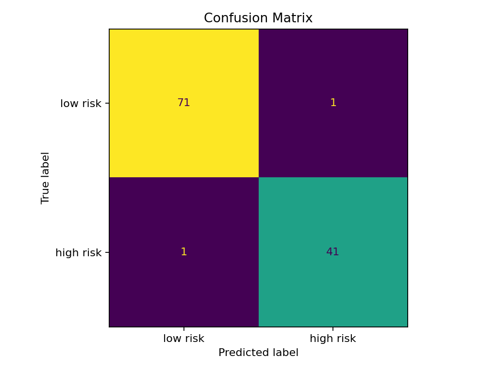
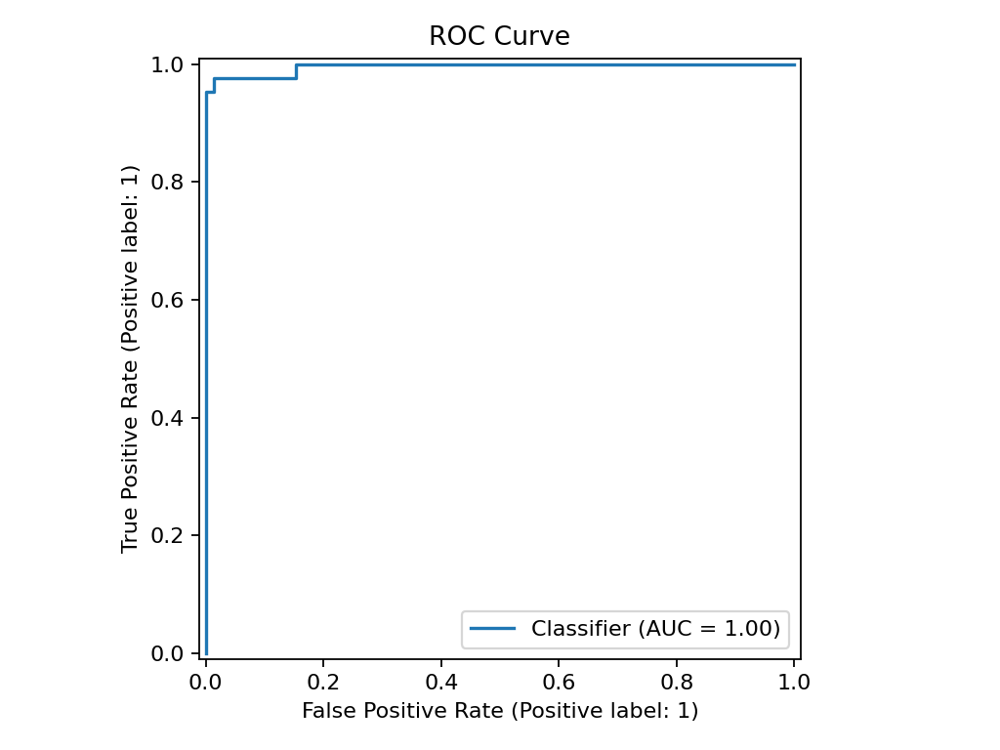
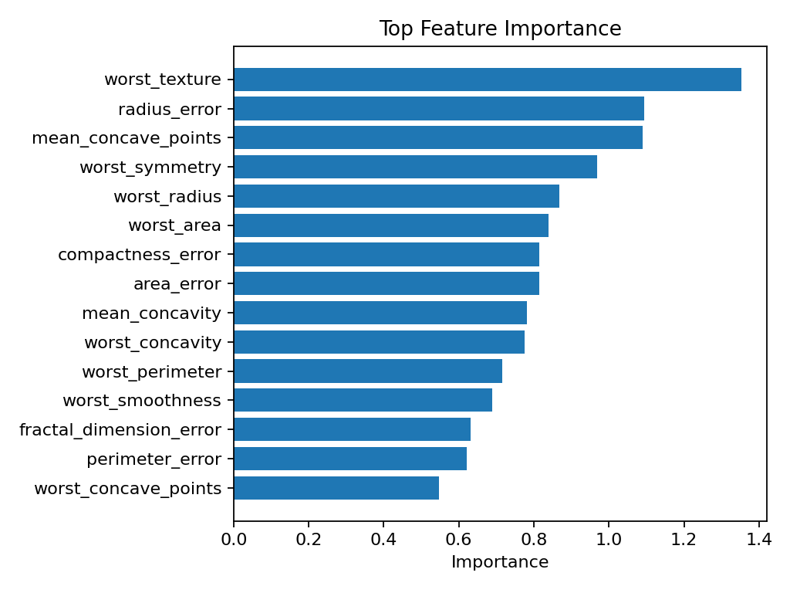

# Applied ML Risk Prediction Demo

## Summary

This project demonstrates a practical supervised machine learning workflow for a binary risk prediction task. It uses the public Wisconsin Diagnostic Breast Cancer dataset bundled with scikit-learn and shows model training, model comparison, held-out evaluation, feature importance, batch prediction, model documentation, and Streamlit demo readiness.

This is not a clinical tool and must not be used for medical, financial, legal, or operational decision-making.

## Problem Framing

The model predicts `risk_label`, where:

- `risk_label = 1`: malignant/high-risk demonstration class
- `risk_label = 0`: benign/lower-risk demonstration class

The goal is to show practical ML engineering skills, not to deploy a real decision system.

## Dataset

- Dataset: Wisconsin Diagnostic Breast Cancer dataset
- Source: `sklearn.datasets.load_breast_cancer`
- Data type: public demonstration dataset
- Rows: 569 before train/test split
- Features: 30 numeric diagnostic measurements
- Target: `risk_label`

## ML Workflow

1. Prepare data and create train/test splits.
2. Train and compare:
   - Logistic Regression baseline
   - Random Forest model
3. Select the best validation model by ROC AUC when available.
4. Evaluate on held-out test data.
5. Export metrics, predictions, confusion matrix, feature importance, and plots.
6. Run batch prediction.
7. Optionally run a Streamlit demo app.

```text
prepare_data.py -> train_model.py -> evaluate_model.py -> predict.py -> optional Streamlit app
```

## Current Results

The current run selected Logistic Regression based on validation ROC AUC.

Held-out test metrics:

| Metric | Value |
| --- | ---: |
| Accuracy | 0.9825 |
| Precision | 0.9762 |
| Recall | 0.9762 |
| F1 | 0.9762 |
| ROC AUC | 0.9960 |

These metrics are for a small public teaching dataset and should not be interpreted as evidence of real-world deployment reliability.

## Evaluation Plots

Confusion matrix:



ROC curve:



Feature importance:



## Tools Used

- Python
- pandas
- scikit-learn
- matplotlib
- joblib
- Streamlit

## Repository Structure

```text
applied-ml-risk-prediction-demo/
  data/
    processed/
      train.csv
      test.csv
      feature_info.csv
  models/
    risk_prediction_model.joblib
    model_metadata.json
  outputs/
    evaluation_metrics.csv
    confusion_matrix.csv
    predictions_sample.csv
    batch_predictions.csv
    evaluation_summary.md
  reports/
    model_card.md
    evaluation_report_template.md
  src/
    prepare_data.py
    train_model.py
    evaluate_model.py
    predict.py
    app.py
  run_project.py
```

## How To Run

From the repository root:

```powershell
python .\applied-ml-risk-prediction-demo\src\prepare_data.py
python .\applied-ml-risk-prediction-demo\src\train_model.py
python .\applied-ml-risk-prediction-demo\src\evaluate_model.py
python .\applied-ml-risk-prediction-demo\src\predict.py
```

Or run the full workflow:

```powershell
python .\applied-ml-risk-prediction-demo\run_project.py
```

Optional Streamlit app:

```powershell
streamlit run .\applied-ml-risk-prediction-demo\src\app.py
```

## Outputs Generated

- `data/processed/train.csv`
- `data/processed/test.csv`
- `data/processed/feature_info.csv`
- `models/risk_prediction_model.joblib`
- `models/model_metadata.json`
- `outputs/evaluation_metrics.csv`
- `outputs/confusion_matrix.csv`
- `outputs/predictions_sample.csv`
- `outputs/feature_importance.csv`
- `outputs/evaluation_summary.md`
- `outputs/batch_predictions.csv`
- `outputs/confusion_matrix.png`
- `outputs/roc_curve.png`
- `outputs/feature_importance.png`

## Reports

- [Model card](reports/model_card.md)
- [Evaluation report](reports/evaluation_report.md)
- [Model validation notes](outputs/model_validation_notes.md)
- [Recruiter project summary](docs/recruiter_project_summary.md)

## Limitations

- This is a public teaching dataset, not New Zealand operational data.
- The model is not validated for real clinical use.
- High test metrics on this small dataset do not imply production reliability.
- The Streamlit app is a portfolio demo only.

## Future Improvements

- Add cross-validation.
- Add threshold tuning and calibration.
- Add data drift checks.
- Add a richer model comparison table.
- Adapt the workflow to a New Zealand public-sector non-sensitive dataset.
