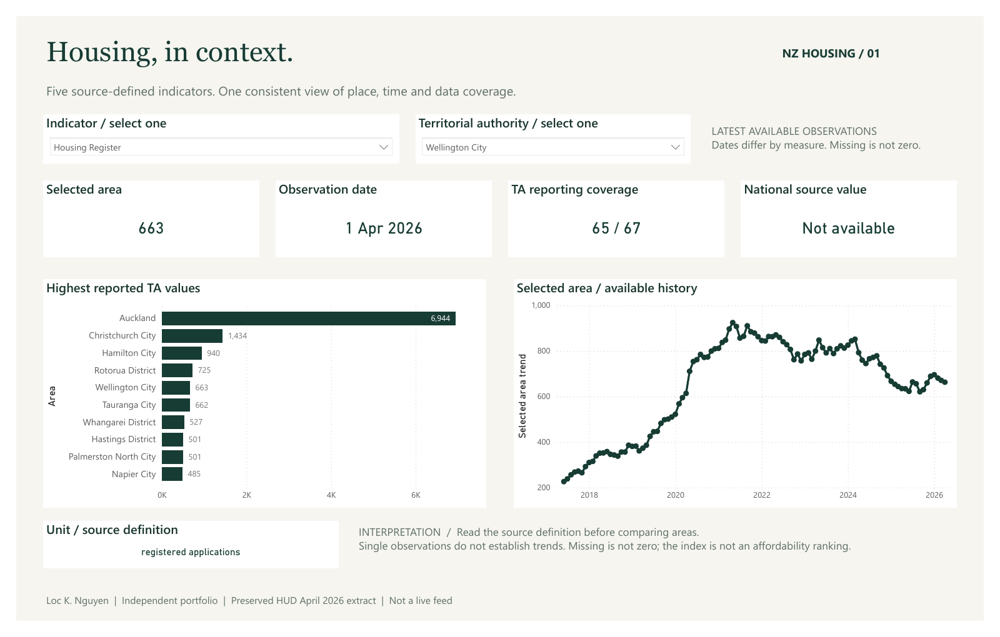

# NZ Housing | Power BI report

**Completed and tested in Power BI Desktop on 16 October 2026**, version 2.154.956.0 (May 2026).

[Download PBIX](NZHousing.pbix) · [Three-page PDF](NZHousing.pdf) · [Browser explorer and previews](https://loc-k-nguyen.github.io/loc-nz-data-ai-portfolio/#powerbi)

Open `NZHousing.pbix` in Power BI Desktop. It contains the data and needs no sign-in, credentials, network connection, or private source path. A newer Desktop version may be required if an older version cannot open it. The PDF is a static export of the saved defaults; filters work in the PBIX.

## Three pages

1. **Housing, in context.** Indicator and territorial-authority slicers, latest observed value/date, TA coverage, same-date published national value, ten highest reported TA values, and selected-area history.
2. **Inspect the observations.** Exact values, geography, units and dates, with optional date filtering and no mixed-unit totals. Each page has its own filters.
3. **Data quality is part of the report.** Source and selected-key counts, a five-series catalog, reporting dates, coverage, definitions and interpretation limits.

## Model and calculations

Five typed Power Query import tables: `Observation`, `Indicator`, `Area`, `Date`, and a disconnected `Area picker`. The first four form a star model; `TREATAS` applies the area selection without reducing the comparison chart to one area. Twenty DAX measures calculate latest values, date, coverage, national values, history and quality checks. Dynamic format strings retain numeric values while displaying counts, currency, percentages and indices appropriately.

The model embeds **13,685 exact observations**, selected with the same parameterized SQLite workflow as the browser explorer. Source fractions are preserved: Wellington rent burden `0.426` displays as **42.6%**. Ambiguous selected keys stop the build. Missing observations stay blank; measures require a single indicator and never sum incompatible units. Latest reporting dates are measure-specific. National values use an actual same-date NZ record; they are not invented TA aggregates.

The preserved April 2026 HUD extract is **not a live feed**. Refresh reloads the embedded extract, not the current HUD website. To change source vintage, follow the source-review process in [REPRODUCE.md](../../../REPRODUCE.md), regenerate the project, open and refresh it in Desktop, rerun checks, then save/export again.

## Verification and editable source

- [Reference values, checksum and coverage](validation_reference.json)
- [Actual read-only Desktop DAX results](desktop_validation.json): five Wellington values/dates/coverage, real national index, 13,685 rows, zero selected duplicate keys, blank mixed-unit measure, and missing Chatham Islands rent.
- Desktop UI: all three pages rendered; switched indicators to percentage and currency; missing-area selection showed **Not available**. Saved PBIX was reopened and its engine checks repeated. All PDF pages were visually inspected.
- `NZHousing.pbip`, `NZHousing.Report/` and `NZHousing.SemanticModel/` are the editable source. PBIP/PBIR features may need enabling in Desktop. Keep TMSL if offered an optional TMDL preview conversion.
- From repository root, `python scripts/build_powerbi_report.py` regenerates the source project from the cleaned extract. This overwrites generated definitions, so commit or back up any manual customizations first. It does not fabricate a PBIX or run Desktop validation.
- To repeat native checks, use `scripts/validate_powerbi_desktop.ps1 -Server localhost:<Desktop-port> -Catalog <open-model-catalog>`. This uses Microsoft's local ADOMD client, reads only the open Desktop model, and does not publish anything. See Microsoft's [external tools documentation](https://learn.microsoft.com/en-us/power-bi/transform-model/desktop-external-tools).
- CI checks the portable model builder, references, source fidelity, native slicer envelope and typed visual formatting. Native Desktop UI testing is a separate Windows check, not a CI claim.

Source attribution: [HUD Local Housing Statistics](https://www.hud.govt.nz/stats-and-insights/local-housing-statistics/about-the-local-housing-statistics-dashboard). Descriptive independent portfolio work by Loc K. Nguyen. No stakeholder deployment, policy recommendation or PL-300 certification is claimed. Earlier manual build assets are retained only as historical reference; the finished report uses this model.
