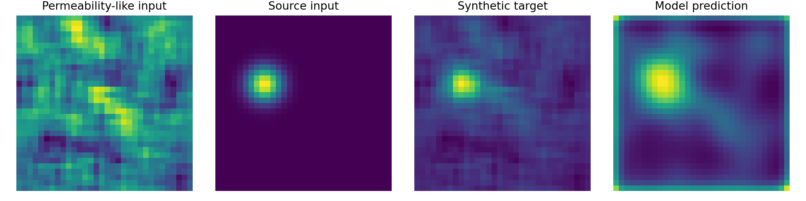
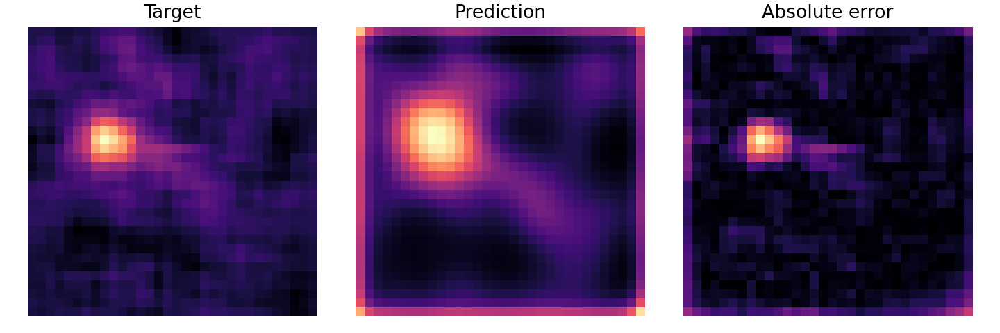

# Scientific ML Research Showcase

## Summary

This project is a synthetic demonstration of a scientific ML surrogate workflow, not a reproduction of private PhD experiments. It generates deterministic 2D permeability-like and source fields, trains a lightweight PyTorch surrogate to predict a plume-like output field, evaluates field-level metrics, and writes research-style reports and plots.

## Why Scientific ML Matters

Scientific ML can approximate expensive simulations, support rapid experimentation, and help researchers explore model behavior before running larger experiments. This project demonstrates the workflow structure in a safe, local, synthetic setting.

## What This Project Demonstrates

- Synthetic scientific field generation
- Configuration-driven experiment setup
- PyTorch Dataset and DataLoader usage
- Small CNN and Mini U-Net surrogate models
- Train/validation/test split
- Field metrics: MAE, RMSE, relative MAE, field correlation, SSIM-like score
- Prediction and error-map visualizations
- Experiment summary and reproducibility documentation

## Synthetic Data Disclaimer

All data and results are synthetic demonstration data. No private PhD data is used. No result should be interpreted as a thesis result, real groundwater result, or validated scientific conclusion.

## Problem Framing

Input:

- Channel 1: permeability-like smooth random field
- Channel 2: source/location Gaussian field

Target:

- Plume-like concentration field generated from a transparent formula influenced by the input fields

The task is field-to-field regression: learn a surrogate mapping from synthetic inputs to synthetic target fields.

## Model Approach

Default model:

```text
mini_unet
```

Alternative implemented model:

```text
small_cnn
```

The defaults are intentionally small so the project runs locally on CPU.

## How To Reproduce

From the repository root:

```powershell
python .\scientific-ml-research-showcase\run_project.py
```

Individual commands:

```powershell
python .\scientific-ml-research-showcase\src\train.py
python .\scientific-ml-research-showcase\src\evaluate.py
```

## Outputs

- `outputs/metrics.csv`
- `outputs/training_history.csv`
- `outputs/prediction_examples.png`
- `outputs/error_map_examples.png`
- `outputs/experiment_summary.md`
- `outputs/evaluation_metrics.csv`
- `outputs/evaluation_summary.md`
- `models/scientific_surrogate_model.pt`
- `models/model_metadata.json`

## Current Synthetic Demonstration Metrics

Latest local run, test split:

| Metric | Value |
| --- | ---: |
| MAE | 0.051088 |
| RMSE | 0.081656 |
| Relative MAE | 0.280343 |
| Field correlation | 0.701694 |
| Simple SSIM-like score | 0.605504 |

These are synthetic demonstration metrics only. They should not be interpreted as real scientific performance.

## Example Results

Surrogate predictions against the synthetic target fields:



Per-pixel error maps for the same samples:



Both figures are regenerated by `run_project.py` and show synthetic demonstration data only.

## Relation To My PhD Skills

This project shows research engineering skills that are relevant to scientific machine learning: surrogate framing, synthetic experiment design, configuration-driven runs, PyTorch implementation, metrics, visualization, reproducibility, and cautious reporting. It does not expose private data and does not claim to reproduce thesis experiments.

## Limitations

- Synthetic data only
- Small model
- Short local training run
- No real scientific validation
- No uncertainty quantification
- No temporal prediction
- No HPC training in this version

## Future Extensions

- Replace synthetic data with approved public scientific benchmark data
- Add larger surrogate models
- Add temporal prediction
- Add uncertainty quantification
- Add experiment tracking
- Scale longer runs to Rāpoi/ECS only when needed
